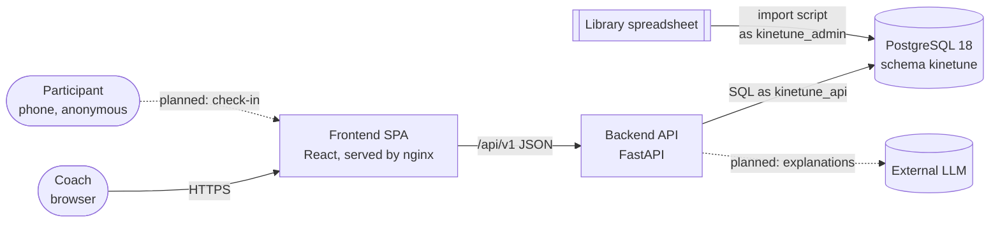
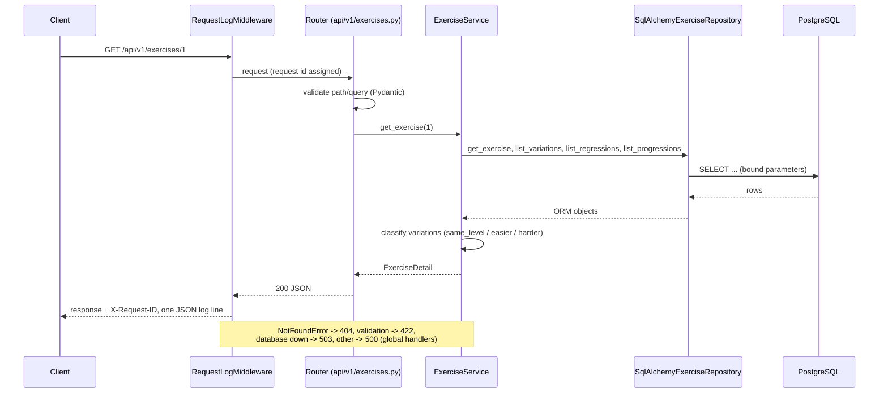

# Architecture overview

## System context

The library is written only by the import script; the API reads it. Dashed arrows are planned parts.

## Request flow

## Modules (backend)

| Module | Responsibility |
|---|---|
| `app/api/` | HTTP layer: routers, parameter validation, dependency wiring (`deps.py`) |
| `app/services/` | Business logic (e.g. variation levels from the two graphs) |
| `app/repositories/` | Data access; the service depends on a protocol, so tests use an in-memory fake |
| `app/models/` | SQLAlchemy ORM models over the existing schema (created by Alembic migrations in `db/`) |
| `app/schemas/` | Pydantic request/response models and enumerations; the OpenAPI schemas come from here |
| `app/core/` | Settings from environment variables, JSON logging, error classes and global handlers |

## Resources

| Resource | Endpoints | Notes |
|---|---|---|
| Exercise | `/api/v1/exercises`, `/api/v1/exercises/{id}` | Read-only |
| Family | `/api/v1/families` | Read-only; families are the hubs of the variation graph |
| Health | `/health` | Outside the versioned API |
