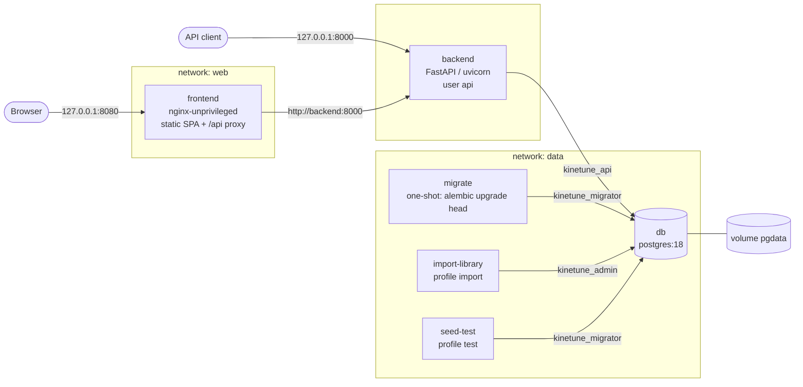

# Containers

The whole stack runs with Docker Compose from the repository root (`docker-compose.yml`). Every project component has its own Dockerfile; PostgreSQL uses the official image.

## Launch

```bash
cp .env.example .env                 # set real passwords (see the variables below)
docker compose up -d --build         # db -> migrate -> backend -> frontend
docker compose --profile import run --rm import-library      # load the exercise library
docker compose ps                    # all long-running services should be "healthy"
```

| URL (this machine only) | Service |
|---|---|
| <http://localhost:8080> | Frontend (SPA); `/api` is proxied to the backend |
| <http://localhost:8000/docs> | Backend: Swagger UI; API under `/api/v1` |
| `localhost:5432` | PostgreSQL (for database clients) |

Stop: `docker compose down` (data kept in the volume). Delete everything including data: `docker compose down -v`.

## Container architecture



`backend` is attached to both networks; the frontend cannot reach the database (separate network).

Start order (`depends_on`): `db` healthy → `migrate` completed successfully → `backend` healthy → `frontend`.

## Images

| Service | Image (tag = `APP_VERSION`) | Dockerfile | Purpose | Base | Size | User |
|---|---|---|---|---|---|---|
| `frontend` | `kinetune-frontend:0.1.0` | `frontend/Dockerfile` | Serves the built SPA, proxies `/api` to the backend | build: `node:22.12-alpine` → runtime: `nginxinc/nginx-unprivileged:1.27-alpine` | ~76 MB | `nginx` (101) |
| `backend` | `kinetune-backend:0.1.0` | `backend/Dockerfile` | REST API (FastAPI, uvicorn) | build: `python:3.12-slim` (venv) → runtime: `python:3.12-slim` | ~337 MB | `api` |
| `migrate`, `import-library` | `kinetune-db-tools:0.1.0` | `db/Dockerfile` | Alembic migrations; library import script | `python:3.12-slim` | ~271 MB | `migrator` |
| `db`, `seed-test` | `postgres:18` (official) | — | Database; test data loader (psql) | — | — | `postgres` |

Build rules used in all Dockerfiles:
- **Layer order:** dependency files are copied and installed first, application code last, so code changes reuse the cached dependency layers.
- **Multi-stage:** frontend (Node only in the build stage) and backend (pip/venv built in a separate stage); no compilers or dev tools in runtime images; pip runs with `PIP_NO_CACHE_DIR`, npm cache stays in the build stage.
- **Non-root:** every image ends with `USER`.
- **No secrets in images:** all settings come from environment variables at run time; `.env` is excluded by `.dockerignore`.
- **`.dockerignore`** in `backend/`, `frontend/` and `db/` (caches, `node_modules`, build output, tests, the library workbook).
- **Versioned tags:** images are tagged with `APP_VERSION` (default `0.1.0`), never `latest`.
- **Healthchecks:** backend `GET /health` (also checks the database), frontend HTTP check of nginx, db `pg_isready`.
- **EXPOSE:** backend 8000, frontend 8080 (the unprivileged nginx does not bind ports below 1024).

## Environment variables

All values are read from `.env` (template: `.env.example`). `.env` is git-ignored.

| Variable | Used by | Description |
|---|---|---|
| `POSTGRES_DB` | db, migrate, backend, import, seed | Database name (`kinetune`) |
| `POSTGRES_USER`, `POSTGRES_PASSWORD` | db | Cluster superuser — bootstrap and maintenance only |
| `MIGRATOR_PASSWORD` | db (init), migrate, seed | Login role `kinetune_migrator` (owns the objects, runs migrations) |
| `API_PASSWORD` | db (init), backend | Login role `kinetune_api` used by the backend (`DB_PASSWORD`) |
| `READER_PASSWORD` | db (init) | Login role `kinetune_reader` (read-only reports) |
| `ADMIN_PASSWORD` | db (init), import-library | Login role `kinetune_admin` (library import) |
| `DB_PORT` | db | Host port of PostgreSQL (default 5432, bound to 127.0.0.1) |
| `API_PORT` | backend | Host port of the API (default 8000, bound to 127.0.0.1) |
| `WEB_PORT` | frontend | Host port of the frontend (default 8080, bound to 127.0.0.1) |
| `LOG_LEVEL` | backend | `DEBUG`, `INFO` (default), `WARNING`, `ERROR` |
| `APP_VERSION` | all built images | Image tag (default `0.1.0`) |

Variables set inside `docker-compose.yml` (not in `.env`): backend `DB_HOST=db`, `DB_PORT=5432`, `DB_NAME`, `DB_USER=kinetune_api`, `DB_PASSWORD`; frontend `BACKEND_URL=http://backend:8000`.

## Volumes and persistent data

| Volume / mount | Service | Content |
|---|---|---|
| `pgdata` (named volume) | db | All database data; survives `docker compose down`, deleted by `down -v` |
| `./db/init` (read-only) | db | Login-role scripts, run once on an empty volume |
| `./db/library` (read-only) | import-library | The library workbook |
| `./db/seed` (read-only) | seed-test | Test data SQL |

The application stores no uploaded files.

## Privacy in the containers

Neither the backend nor nginx logs client IP addresses (NFR7): uvicorn runs with `--no-access-log` and the backend logs requests itself without the address; nginx uses a log format without `$remote_addr` and keeps the error log at `crit`. All ports are bound to `127.0.0.1`.

## Resource requirements

Measured idle with the imported library: backend ~70 MB RAM, PostgreSQL ~40 MB, frontend ~10 MB; CPU near 0 % at rest.

| | Minimum | Recommended |
|---|---|---|
| CPU | 1 core | 2 cores |
| RAM (containers) | 1 GB | 2 GB |
| Disk | 3 GB (images ~1 GB incl. postgres, build cache, data) | 5 GB |
| Software | Docker Engine 24+ with Compose v2 | — |
