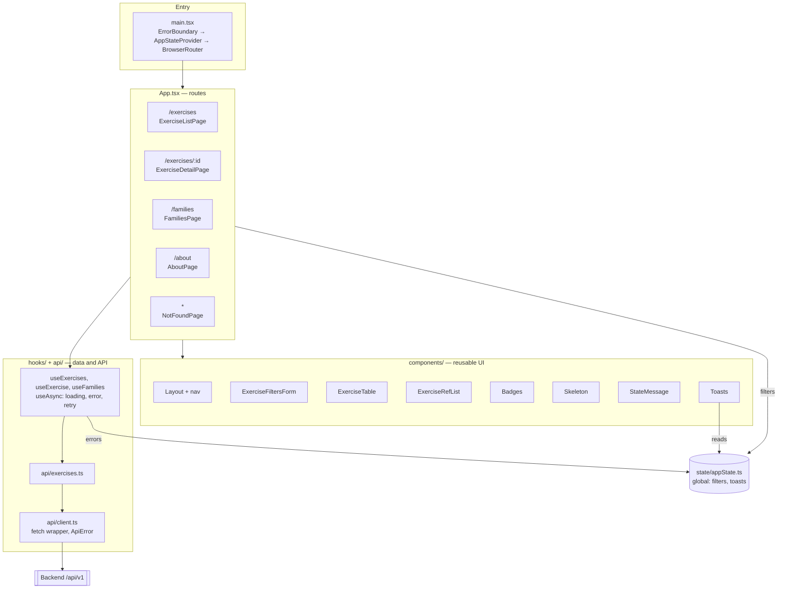
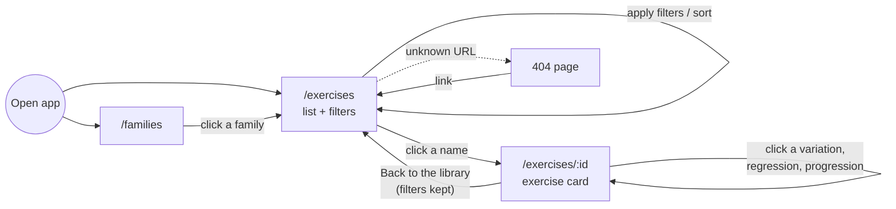

# Frontend architecture

Single Page Application for the coach. **Prototype slice (v0.1.0):** the exercise library (list, filters, sorting, exercise card, families). Code: `frontend/`.

## Architecture diagram



## Approach

- **Component-based, container/presentational split.** Pages (`pages/`) are containers: they read the global state, call the data hooks and decide which state to show (loading, error, empty, data). Components (`components/`) are presentational and reusable: they get data and callbacks through props.
- **Data access in one place.** Components never call `fetch`. `api/client.ts` is the only HTTP wrapper (base URL, JSON, error mapping to `ApiError`); `api/exercises.ts` has one function per endpoint; `hooks/` wrap them with loading/error state.
- **Global state: React Context + `useReducer`** (`state/appState.ts`). Two small slices need to live across routes: the library filters (kept when the coach opens an exercise and comes back) and the toast queue (any page can report an error). A state library (Redux, Zustand) would add a dependency and boilerplate for two slices; the reducer is a pure function and is unit-tested. Server data is not cached globally — each page loads what it shows.
- **Local state** for form drafts (`ExerciseFiltersForm`) and per-request loading/error (`useAsync`).
- **Types:** `types/api.ts` mirrors the API data models ([docs/api/reference/data-models.md](../api/reference/data-models.md)); no `any` (ESLint rule `no-explicit-any` is an error).

## Project structure

| Folder | Content |
|---|---|
| `src/pages/` | Route containers |
| `src/components/` | Reusable UI: layout, form, table, lists, badges, skeletons, state messages, toasts, error boundary |
| `src/hooks/` | `useAsync` and the library data hooks |
| `src/api/` | HTTP client and the exercise service |
| `src/state/` | Global state (context, reducer, provider) |
| `src/types/` | API data interfaces and enumerations |
| `src/utils/` | Labels, validation rules, logger |
| `src/styles/` | `tokens.css` (palette, type, spacing) → `base.css` → `layout.css` → `components.css` |

## API used

The client uses the endpoints documented in [docs/api](../api/README.md):

| Screen | Endpoint |
|---|---|
| Exercise library | `GET /api/v1/exercises` (filters `q`, `mode`, `difficulty`, `family_id`, `sort`), `GET /api/v1/families` (filter options) |
| Exercise card | `GET /api/v1/exercises/{id}` |
| Families | `GET /api/v1/families` |

In development Vite proxies `/api` to the backend (`API_PROXY_TARGET`, default `http://localhost:8000`); in the container nginx serves the build and proxies `/api` to the backend service, so the browser talks to one origin (no CORS).

## User flows



Main flow ("find a gentler exercise"): open the library → filter by family → open the exercise → pick a variation marked **Easier** → check its joints and load.

## Error handling and loading

| Situation | Behaviour |
|---|---|
| Rendering error | `ErrorBoundary` shows a fallback with "Reload"; the error is logged |
| 404 (unknown exercise, bad id) | The page shows "Exercise not found" (no request for an invalid id) |
| 422 | The form validates first (search 2–100 characters), so the API does not see invalid input |
| 401 / 403 | Mapped to "Please sign in" / "No access" messages (ready for authentication) |
| 500 / 503 / network | Toast with a clear message + error state with "Try again" |
| Loading | Skeletons for lists and the card |

All API errors are logged to the console by `utils/logger.ts` with status, code and request id (no personal data).

## Responsive and accessible UI

- Breakpoints in `em`: phone < 40em (640 px), tablet 40–64em, desktop ≥ 64em. Card grid 1 / 2 / 3 columns; the filter form 1 / 2 / 5 columns.
- The table turns into stacked cards on phones (`data-label`), so there is no horizontal scroll at 360 px.
- Relative units everywhere (`rem`, `em`, `%`, `clamp()` for the H1), so browser zoom and system font size scale the interface.
- Touch targets ≥ 44 px (`--touch-target`): buttons, links in lists, form fields, navigation, the toast close button.
- Contrast ≥ 4.5:1 for all text colours (values in `tokens.css`), visible focus outline, labels on every field, `aria-live` for the result count and toasts, `prefers-reduced-motion` respected.
- The navigation stays in a sticky header on every screen size.

## Tech stack

| Choice | Why |
|---|---|
| React 18 + TypeScript | Component model fits the screens; TypeScript catches API contract mistakes at build time; large ecosystem for tests (Testing Library) |
| Vite | Fast dev server with an API proxy, simple production build |
| React Router 6 | Standard client-side routing with nested layout routes |
| Context + useReducer | Enough for two global slices; no extra dependency (see Approach) |
| Custom components + CSS tokens | A small UI; a UI kit would add weight. Tokens keep one palette and type scale |
| ESLint (typescript-eslint, react-hooks) + Prettier | Code quality and one formatting style (`npm run lint`, `npm run format:check`) |

## Commands

```bash
cd frontend
npm ci
npm run dev            # http://localhost:5173, API proxied to http://localhost:8000
npm run lint
npm run format:check
npm run build          # type check + production build into dist/
```
